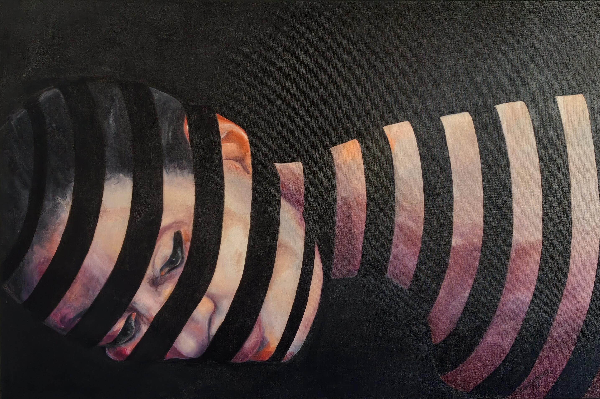

# Tagtraum

**Titel:** Tagtraum  
**Technik:** Öl auf Leinwand  
**Größe:** 80 × 120 × 4,5 cm  
**Jahr:** 2023  
**Preis:** € 3.600

## Bildbeschreibung

In Tagtraum erscheint ein Gesicht, das sich dem Blick nur teilweise preisgibt. Dunkle, rhythmisch gesetzte Bögen schneiden durch das Porträt und lösen es in einzelne Bildfragmente auf. Haut, Auge und Mund treten hervor, verschwinden wieder und lassen das Gesicht zwischen Präsenz und Auflösung schweben.

Die tiefschwarze Umgebung verstärkt diese Wirkung. Sie wirkt wie ein innerer Raum, in dem Gedanken keine feste Form annehmen müssen. Das Bild erzählt keinen konkreten Traum; es öffnet vielmehr einen Moment des Abschweifens, in dem sich Wahrgenommenes und Vorgestelltes überlagern. Der Blick wandert von Ausschnitt zu Ausschnitt und setzt das Gesicht im eigenen Sehen immer wieder neu zusammen.

Tagtraum lädt dazu ein, kurz aus der äußeren Wirklichkeit herauszutreten und den flüchtigen Bildern des Inneren zu folgen.
